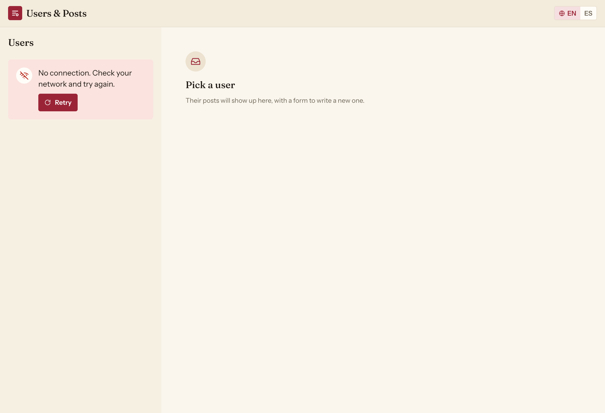
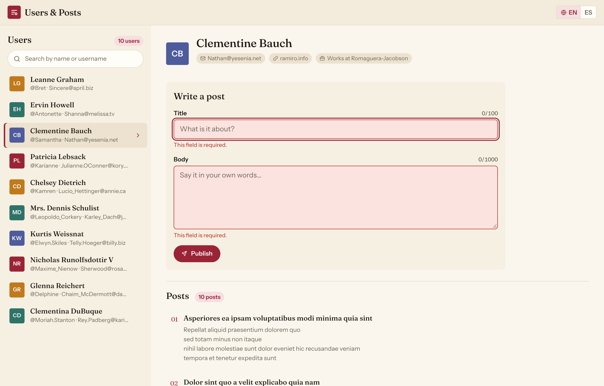
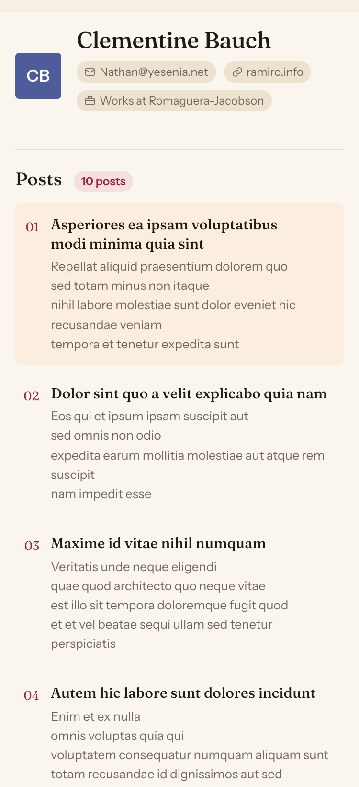

# Users & Posts

[](https://github.com/ernestgonzalezv/users-posts-react/actions/workflows/ci.yml)
[](https://codecov.io/gh/ernestgonzalezv/users-posts-react)
[](src)

A small React 19 + TypeScript app over the public [JSONPlaceholder](https://jsonplaceholder.typicode.com)
API: search users by name, read the chosen user's posts, write a new one. English and Spanish, light,
dark or the system theme, the chosen user in the URL, every screen with its loading, empty and error
states.


<details>
<summary>More screenshots</summary>

| Dark theme | No match (Spanish) | Offline |
|---|---|---|
|  |  |  |

| Invalid form | Server failure, draft kept | Phone |
|---|---|---|
|  |  |  |

</details>

## Run it

Node 20 or newer.

```sh
npm ci
npm run dev        # http://localhost:5173
npm run dev:slow   # same, every API answer delayed two seconds to watch the loading states
```

| Command | What it does |
|---|---|
| `npm run test` | the unit and component suite with Vitest (227 tests in 44 files) |
| `npm run test:coverage` | the suite with V8 coverage; fails under 100 % on lines, statements, functions and branches; HTML report in `coverage/` |
| `npm run test:e2e` | the Playwright journeys (10, Chromium desktop and a Pixel 7) over the production build; `npx playwright install chromium` once |
| `npm run typecheck` | `tsc -b --noEmit`, strict with `exactOptionalPropertyTypes` |
| `npm run lint` | ESLint with the type-aware rules |
| `npm run build` | production build into `dist/` |
| `scripts/verify.sh` | all of the above plus the ratchets, in order, stopping at the first failure |

## What it does

- **Users** load into the sidebar with a spinner, an error box with Retry (network, timeout, HTTP status,
  malformed body) or an empty state. Each row is a toggle button; the chosen one is tinted and marked.
  Fifty rows at a time, then a "Show N more" button.
- **The chosen user lives in the URL** (`/users/3`): a refresh, a shared link and the back button keep
  or restore the selection, and an address that names nobody gets its own screen with the way back.
- **Search** filters by name or username after a 300 ms debounce, ignoring case and accents on both
  sides (`Érvin` finds `Ervin`). Zero matches is its own state with a "Clear search" action; the pill
  reads `0 of 10` so the total is never lost. Escape clears the box.
- **Posts** of the chosen user load under a header with email, website and company, numbered, with their
  own loading, empty and error states, twenty at a time. Switching users aborts the previous request, so a
  late answer never overwrites the current user.
- **New post**: title and body required after trimming, 100 and 1000 characters at most, per-field
  messages, focus on the first faulty field, live counters that count graphemes (one family emoji is one
  character). One request per submit. The post lands at the top at once, marked "Sending"; on success it
  becomes "New" with a toast, on failure it is rolled back, the draft is restored and the error shows
  inline with Retry.
- **Written posts are kept per user** in `localStorage`, so switching users or reloading does not drop
  them; the API does not persist writes.
- **Any input** survives: control and zero-width characters are stripped, blank lines collapse, blank
  names fall back to the username, a repeated id is dropped, a 300-character email or a title made of
  one word cannot widen the page, a thousand users stay usable.
- **Language** (EN/ES) and **theme** (light, dark or system) switches in the app bar; both persist in
  `localStorage`, the theme is applied before the first paint, and "system" follows the OS live.
- **Phone**: the layout stacks and choosing a user scrolls to the detail; smooth scrolling is turned off
  under `prefers-reduced-motion`.

## Architecture

Clean Architecture per feature. Components never call `fetch` or know a route; `domain/` and `data/` never
import React; the data layer returns `Result<T>` and never throws to control flow.

```
src/
  core/            Result<T>, AppError (a union by kind), HttpClient (timeout + abort, guard-validated), storage, config
  i18n/            typed EN/ES dictionaries (en.ts is the source of truth, a missing Spanish key fails tsc), LocaleProvider, useT()
  theme/           ThemeProvider, stored choice then prefers-color-scheme
  shared/ui/       AppBar, SegmentedControl, LanguageSwitch, ThemeSwitch, SearchField, Spinner, ErrorBox, EmptyState, Toast, Avatar, icons
  shared/presentation/  useResource (idle | loading | success | empty | error), useDebouncedValue, errorMessage
  features/users/  domain/{model,repository,usecase}  data/{dto,mapper,repository}  presentation/
  features/posts/  same shape: GetUserPosts, CreatePost (+ validateDraft), HttpPostRepository, PostList, NewPostForm
  di/container.ts  wires HttpClient -> repositories -> use cases; provided through context
  styles/          tokens.css (every colour and spacing, light and dark blocks), global.css
```

Every multi-outcome value is a discriminated union (`status`, `error.kind`, `submission.status`), never a
set of booleans, so each branch is explicit and exhaustive.

## Decisions

The decisions are written where they were taken:

- [`docs/adr/`](docs/adr/README.md) — layers, `Result` and errors, the five UI states, testing, i18n,
  git and PRs, code style (no comments, no `any`, no `enum`).
- [`specs/users-posts/`](specs/users-posts/spec.md) — the spec, the [plan](specs/users-posts/plan.md)
  with the invariants and their proofs, and the [open items ledger](specs/users-posts/open-items.md)
  with one section per PR.

A few worth calling out:

- **Local search** over the ten loaded users: the API has no name filter and a request per keystroke
  would only add latency and failure states.
- **Local ids for written posts**: JSONPlaceholder answers `id: 101` to every POST, so the list assigns
  `-1, -2, …` to keep keys unique and marks them "New".
- **Stale answers are dropped by aborting**, not by comparing ids: the loader changes with the user id
  and `useResource` cancels the previous request.
- **Validation lives in the domain** (`validateDraft`); the form translates fault codes and never blocks
  typing with `maxLength`.
- **A "system" theme that follows the OS live** (`matchMedia` change event); the stored choice is one of
  three, and the first paint reads it before React mounts.
- **A router without a library**: one `/users/:id` route over `history` and `popstate`, parsed into a
  union (`home`, `user`, `missing`), because one route does not justify a dependency.
- **Optimistic insert with rollback**: the post shows at once as "Sending"; the failure path restores the
  draft and removes the pending row.
- **Client-side paging, not virtualisation**: enough for a thousand rows without a dependency.

## Testing

Vitest + Testing Library, one test file next to each unit. Queries go by role and accessible name, never
by class or test id, so a failing test means a user would notice. Pure use cases and the HTTP client are
tested without a DOM; hooks with `renderHook`; components with `userEvent`; `src/App.edge.test.tsx`
walks the cross-feature cases (language switch keeps the chosen user, the draft and the written posts;
retry after a network failure; timeout; the chosen user hidden by the search).

End to end: `e2e/` holds ten Playwright journeys over the production build (`vite preview`) with the API
mocked at the network layer from fixtures, in Chromium on a desktop viewport and a Pixel 7 for the
`@mobile` tag. They run as their own CI job and are not part of `scripts/verify.sh`.

No network in tests: `src/test/fake-fetch.ts` routes a fake `fetch` by URL and method.

**Coverage** (V8 through `@vitest/coverage-v8`): 100 % lines, branches and functions over `src/` minus
tests and the entry point, and the thresholds sit at 100 %, so `scripts/verify.sh` and CI fail on the first
line or branch nobody exercises. Every CI run uploads `coverage/lcov.info` to
[Codecov](https://codecov.io/gh/ernestgonzalezv/users-posts-react) through the GitHub App (OIDC, no token
in the repository); Codecov draws the badge above and comments the delta on each pull request, with the
project target set in `codecov.yml`. The HTML report is also uploaded as the `coverage-report` artifact
of each run.

## How it was built

CI is GitHub Actions (`.github/workflows/ci.yml`): the same gate as `scripts/verify.sh`, the Playwright
journeys on Ubuntu 24.04, the semantic title check on pull requests, and the coverage upload to Codecov.

Gitflow: `main` ← `develop` ← one branch per behaviour (`feat/`, `test/`, `docs/`), merged through pull
requests with CI (typecheck, lint, tests, build, semantic title). Each PR carries a manual test script
with screenshots of every state, taken in a real browser, and an accessibility note.

The repo ships its own harness: `scripts/verify.sh` is the done gate, `scripts/ratchet/` holds rules whose
baseline can only shrink (no comments, no literal UI text outside `i18n`, no `fetch` outside `core`),
`scripts/pr-gates.sh` checks the shape of a PR and a 500-production-line ceiling per PR. Two PRs were
closed by that ceiling and split; the history shows it.

## Next steps of 1.0.0 (done)

Everything listed as a next step in 1.0.0 shipped in 1.2.0, one pull request each:

- Written posts kept per user in a local store (#29).
- Paging for long lists, fifty users and twenty posts at a time (#33).
- Optimistic insert with rollback (#30).
- A "system" option in the theme switch, following the OS live (#31).
- End-to-end tests in a real browser with Playwright (#34, #35).
- Router with the chosen user in the URL (#28).

Along the way: any input is accepted and rendered safely (#32), and coverage sits at 100 % with the
thresholds held there (#36).

## Next steps

- Edit and delete a written post; today a written post is only ever added.
- A visual regression check on the Playwright screenshots, so a CSS change that moves something fails CI.
- Virtualise the lists if they ever pass a few thousand rows; paging is enough below that.
- Offline reading: cache the last users and posts with a service worker and show them when the API fails.
- Sync the written posts across tabs with the `storage` event.

## AI usage

An AI coding assistant was used throughout, driven from the terminal with the harness above. The
append-only [`docs/ai-log.md`](docs/ai-log.md) records, per PR, what was asked, what was accepted as
delivered, and what was corrected or rejected. In short:

- **Asked of it:** porting the working harness from the author's other repositories, the PR cut,
  the design variants (one was chosen, the others discarded), each vertical slice with its tests, the
  browser walk of every state, the PR scripts.
- **Decided by the author:** Clean Architecture per feature, English for code and UI with an EN/ES switch,
  unions over boolean flags, spinners over skeletons, no comments in source, gitflow with real PRs, the
  Ledger design, the 500-line ceiling.
- **Corrected along the way:** sync `setState` inside effects rejected by the hooks lint; a closure flag
  the type checker could not see; hooks and providers split for react-refresh; fake timers hanging under
  jsdom with React 19 (real timers instead); a focus call on a still-disabled field; a phone scroll that
  ran before the page had room; the base URL moved into `core/` by a ratchet; two PRs over the ceiling,
  split. Every one of these was caught by a gate, a test or a screenshot before merge, which is the
  point of the harness.
