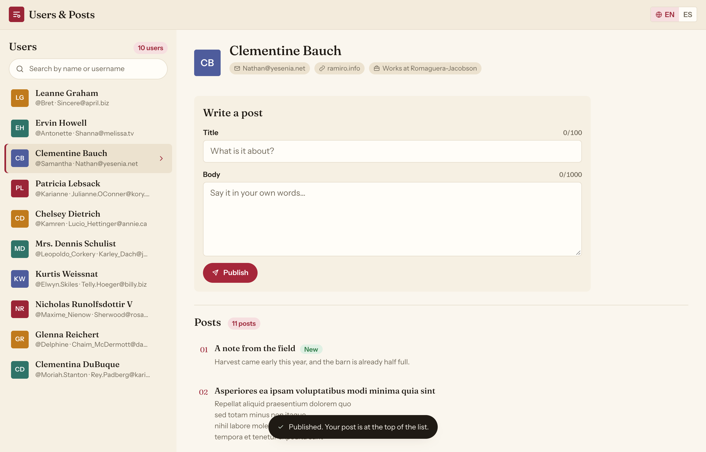
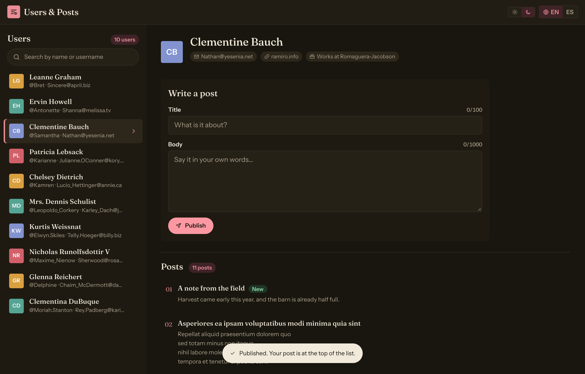
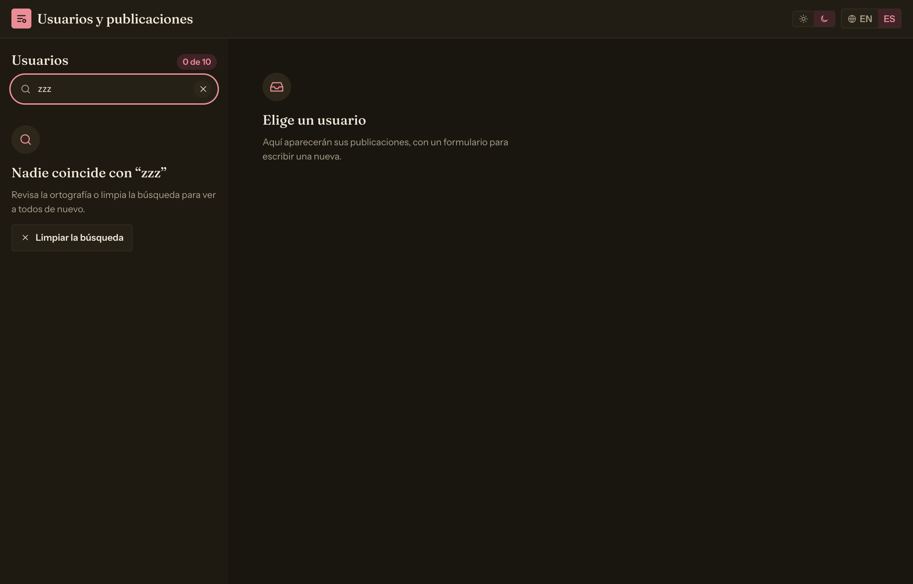
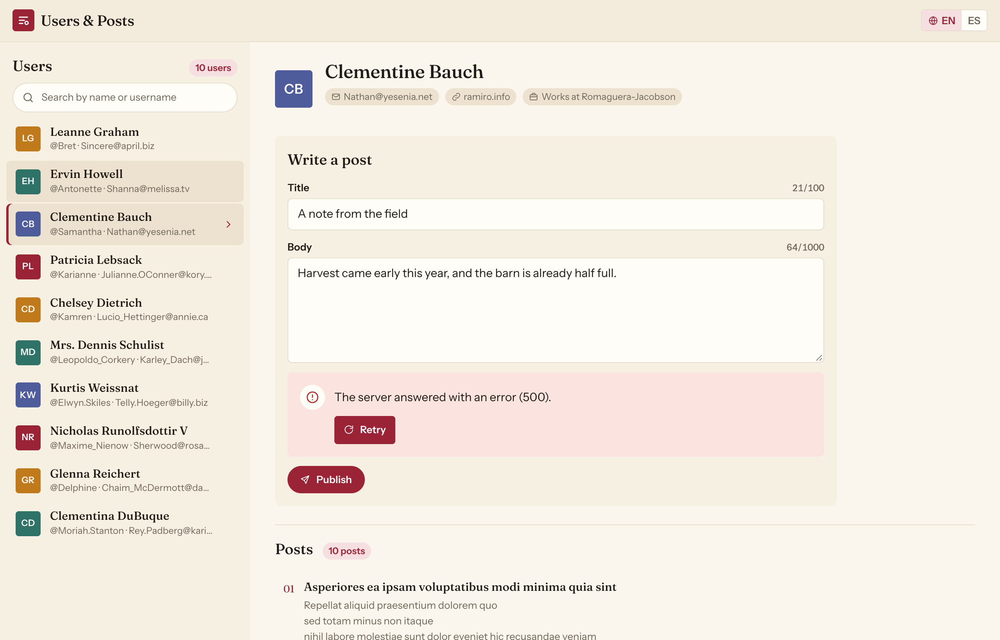

# Users & Posts

[](https://github.com/ernestgonzalezv/users-posts-react/actions/workflows/ci.yml)
[](https://github.com/ernestgonzalezv/users-posts-react/tree/badges)
[](src)

A small React 19 + TypeScript app over the public [JSONPlaceholder](https://jsonplaceholder.typicode.com)
API: search users by name, read the chosen user's posts, write a new one. English and Spanish, light and
dark, every screen with its loading, empty and error states.



<details>
<summary>More screenshots</summary>

| Dark theme | No match (Spanish) | Offline |
|---|---|---|
|  |  |  |

| Invalid form | Server failure, draft kept | Phone |
|---|---|---|
|  |  |  |

</details>

## Run it

Node 20 or newer.

```sh
npm ci
npm run dev        # http://localhost:5173
```

| Command | What it does |
|---|---|
| `npm run test` | the whole suite with Vitest (140 tests in 33 files) |
| `npm run test:coverage` | the suite with V8 coverage; fails under 95 % lines/statements/functions or 90 % branches; HTML report in `coverage/` |
| `npm run typecheck` | `tsc -b --noEmit`, strict with `exactOptionalPropertyTypes` |
| `npm run lint` | ESLint with the type-aware rules |
| `npm run build` | production build into `dist/` |
| `scripts/verify.sh` | all of the above plus the ratchets, in order, stopping at the first failure |

## What it does

- **Users** load into the sidebar with a spinner, an error box with Retry (network, timeout, HTTP status,
  malformed body) or an empty state. Each row is a toggle button; the chosen one is tinted and marked.
- **Search** filters by name or username after a 300 ms debounce, ignoring case and accents on both
  sides (`Érvin` finds `Ervin`). Zero matches is its own state with a "Clear search" action; the pill
  reads `0 of 10` so the total is never lost. Escape clears the box.
- **Posts** of the chosen user load under a header with email, website and company, numbered, with their
  own loading, empty and error states. Switching users aborts the previous request, so a late answer never
  overwrites the current user.
- **New post**: title and body required after trimming, 100 and 1000 characters at most, per-field
  messages, focus on the first faulty field, live counters. One request per submit (the form is disabled
  meanwhile). On success the post lands at the top with a "New" badge and a toast; on failure the draft
  stays and the error shows inline with Retry.
- **Language** (EN/ES) and **theme** (light/dark) switches in the app bar; both persist in `localStorage`,
  the theme is applied before the first paint, and both follow the browser when nothing is stored.
- **Phone**: the layout stacks and choosing a user scrolls to the detail; smooth scrolling is turned off
  under `prefers-reduced-motion`.

## Architecture

Clean Architecture per feature. Components never call `fetch` or know a route; `domain/` and `data/` never
import React; the data layer returns `Result<T>` and never throws to control flow.

```
src/
  core/            Result<T>, AppError (a union by kind), HttpClient (timeout + abort, guard-validated), storage, config
  i18n/            typed EN/ES dictionaries (en.ts is the source of truth, a missing Spanish key fails tsc), LocaleProvider, useT()
  theme/           ThemeProvider, stored choice then prefers-color-scheme
  shared/ui/       AppBar, SegmentedControl, LanguageSwitch, ThemeSwitch, SearchField, Spinner, ErrorBox, EmptyState, Toast, Avatar, icons
  shared/presentation/  useResource (idle | loading | success | empty | error), useDebouncedValue, errorMessage
  features/users/  domain/{model,repository,usecase}  data/{dto,mapper,repository}  presentation/
  features/posts/  same shape: GetUserPosts, CreatePost (+ validateDraft), HttpPostRepository, PostList, NewPostForm
  di/container.ts  wires HttpClient -> repositories -> use cases; provided through context
  styles/          tokens.css (every colour and spacing, light and dark blocks), global.css
```

Every multi-outcome value is a discriminated union (`status`, `error.kind`, `submission.status`), never a
set of booleans, so each branch is explicit and exhaustive.

## Decisions

The decisions are written where they were taken:

- [`docs/adr/`](docs/adr/README.md) — layers, `Result` and errors, the five UI states, testing, i18n,
  git and PRs, code style (no comments, no `any`, no `enum`).
- [`specs/users-posts/`](specs/users-posts/spec.md) — the spec, the [plan](specs/users-posts/plan.md)
  with the invariants and their proofs, and the [open items ledger](specs/users-posts/open-items.md)
  with one section per PR.

A few worth calling out:

- **Local search** over the ten loaded users: the API has no name filter and a request per keystroke
  would only add latency and failure states.
- **Local ids for written posts**: JSONPlaceholder answers `id: 101` to every POST, so the list assigns
  `-1, -2, …` to keep keys unique and marks them "New".
- **Stale answers are dropped by aborting**, not by comparing ids: the loader changes with the user id
  and `useResource` cancels the previous request.
- **Validation lives in the domain** (`validateDraft`); the form translates fault codes and never blocks
  typing with `maxLength`.
- **Two explicit themes**, no "system" entry in the switch: with nothing stored the app follows the OS.

## Testing

Vitest + Testing Library, one test file next to each unit. Queries go by role and accessible name, never
by class or test id, so a failing test means a user would notice. Pure use cases and the HTTP client are
tested without a DOM; hooks with `renderHook`; components with `userEvent`; `src/App.edge.test.tsx`
walks the cross-feature cases (language switch keeps the chosen user, the draft and the written posts;
retry after a network failure; timeout; the chosen user hidden by the search).

No network in tests: `src/test/fake-fetch.ts` routes a fake `fetch` by URL and method.

**Coverage** (V8 through `@vitest/coverage-v8`): about 97 % lines, 95 % branches and 99 % functions over
`src/` minus tests and the entry point. `scripts/verify.sh` runs the suite with coverage, so a drop under
the thresholds fails locally and in CI. The badge above is generated by `scripts/coverage-badge.sh`
(no external service): on every push to `develop` or `main` the workflow writes `coverage-<branch>.svg`
and the JSON summary to the [`badges`](https://github.com/ernestgonzalezv/users-posts-react/tree/badges)
branch. The HTML report is uploaded as the `coverage-report` artifact of each CI run.

## How it was built

Two CI definitions run the same gate: GitHub Actions (`.github/workflows/ci.yml`) and Codemagic
(`codemagic.yaml`: `npm ci`, `scripts/verify.sh`, the coverage badge, `coverage/` and `dist/` as artifacts);
connect the repository in Codemagic to get its build badge.

Gitflow: `main` ← `develop` ← one branch per behaviour (`feat/`, `test/`, `docs/`), merged through pull
requests with CI (typecheck, lint, tests, build, semantic title). Each PR carries a manual test script
with screenshots of every state, taken in a real browser, and an accessibility note.

The repo ships its own harness: `scripts/verify.sh` is the done gate, `scripts/ratchet/` holds rules whose
baseline can only shrink (no comments, no literal UI text outside `i18n`, no `fetch` outside `core`),
`scripts/pr-gates.sh` checks the shape of a PR and a 500-production-line ceiling per PR. Two PRs were
closed by that ceiling and split; the history shows it.

## Next steps

- Keep written posts per user in memory (or a local store) so switching users does not drop them; the
  API does not persist writes.
- Pagination or virtualisation if the lists grow; the ten users and ten posts per user do not need it.
- An optimistic insert with rollback instead of inserting after the answer; today the toast waits for
  the server.
- A "system" option in the theme switch, and the OS preference followed live (`matchMedia` change event).
- End-to-end tests in a real browser (Playwright) on top of the screenshot run used for the PRs.
- Router with the chosen user in the URL so a refresh keeps the selection.

## AI usage

An AI coding assistant was used throughout, driven from the terminal with the harness above. The
append-only [`docs/ai-log.md`](docs/ai-log.md) records, per PR, what was asked, what was accepted as
delivered, and what was corrected or rejected. In short:

- **Asked of it:** porting the working harness from the author's other repositories, the PR cut,
  the design variants (one was chosen, the others discarded), each vertical slice with its tests, the
  browser walk of every state, the PR scripts.
- **Decided by the author:** Clean Architecture per feature, English for code and UI with an EN/ES switch,
  unions over boolean flags, spinners over skeletons, no comments in source, gitflow with real PRs, the
  Ledger design, the 500-line ceiling.
- **Corrected along the way:** sync `setState` inside effects rejected by the hooks lint; a closure flag
  the type checker could not see; hooks and providers split for react-refresh; fake timers hanging under
  jsdom with React 19 (real timers instead); a focus call on a still-disabled field; a phone scroll that
  ran before the page had room; the base URL moved into `core/` by a ratchet; two PRs over the ceiling,
  split. Every one of these was caught by a gate, a test or a screenshot before merge, which is the
  point of the harness.
